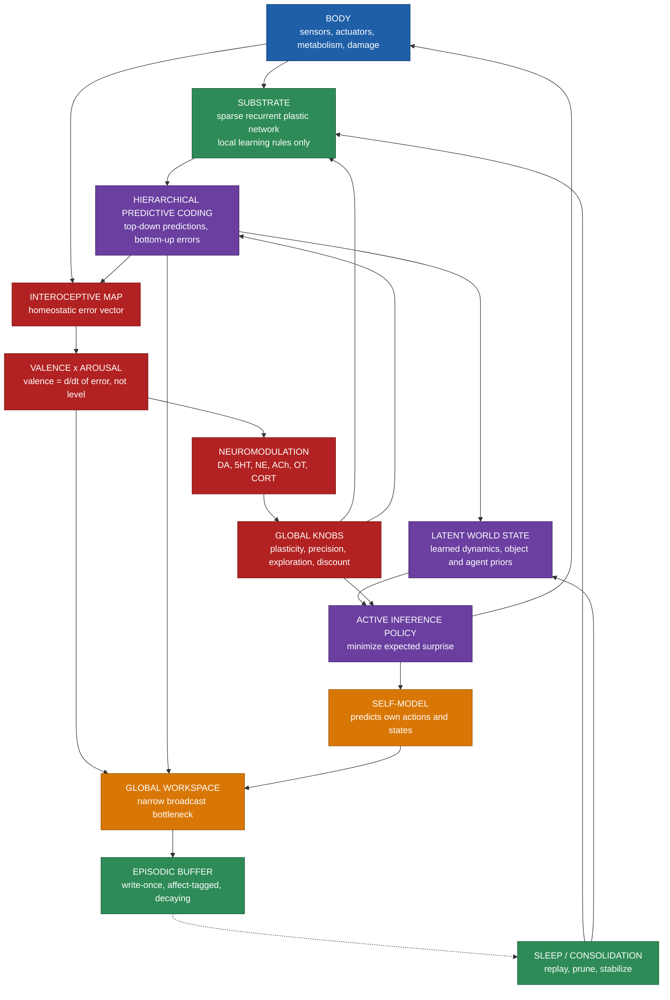

# PROJECT CREATURE — Implementation Specification

- **Version:** 1.0
- **Target runtime:** JAX (CPU dev, single-GPU training)
- **Working package name:** `creature/`
- **Status:** Authoritative. Where this document conflicts with your instincts, this document wins.

---

## 0. How to use this document

You are implementing a research artifact, not a product. The goal is a synthetic organism that learns continuously from its own experience and has causally-effective affect. It is explicitly **not** an LLM wrapper.

Rules for the implementing agent:

1. Read Sections 1–4 before writing any code.
2. Section 2 (Invariants) and Section 3 (Anti-goals) are the highest authority in this document. If a feature would violate an invariant, cut the feature.
3. Implement in the order given in Section 11. Do not skip ahead.
4. Every module in Section 7 has Acceptance Criteria. A module is not done until all criteria pass as automated tests.
5. Do not add dependencies, abstractions, or features not specified here without flagging them in a `DECISIONS.md`.
6. If a spec detail is genuinely ambiguous, make the simplest choice consistent with Section 2, implement it, and log it in `DECISIONS.md`. Do not stall.

---

## 1. Purpose

Build a single, continuously-living artificial organism with these properties:

- **It learns.** All learning is online, from the organism's own sensorimotor experience. There is no training corpus. There is no pretrained checkpoint. Everything the organism knows, it learned by living.
- **It has feelings that are load-bearing.** Affect is computed from the organism's homeostatic state and has causal effects on plasticity, attention, exploration, and action selection. A feeling that does not change computation is a bug.
- **It is one individual.** After a parallel evolutionary phase, exactly one organism is instantiated and then lives continuously without reset for the remainder of the project.
- **It is developed, not designed.** The adult is not specified. A developmental sequence is specified, and the adult emerges.

### 1.1 Why Path D

Two failure modes bracket this design space:

- **Blank slate.** One organism learning everything from scratch. Legitimate but far too slow.
- **Statue.** A pre-tuned system that already knows everything. Fast but never learns.

Path D splits the difference along a principled seam: evolution runs offline and in parallel to produce an *endowment*, which is then handed to one individual as its *genome*. The individual then lives continuously and learns only from its own life. This mirrors biology: evolution produces a creature that learns fast; it does not produce a creature that already knows.

The correctness of the whole project is measured by the **Growth Ratio** (Section 9.3). Target band: **0.40–0.60**.

---

## 2. Non-negotiable invariants

These may not be violated by any implementation choice. Each has a corresponding test.

| # | Invariant | Test |
|---|-----------|------|
| I1 | **No pretrained checkpoints.** Every weight in the living organism originates either from the evolved genome or from the organism's own lifetime plasticity. | `test_no_pretrained` — assert no weight tensor is loaded from disk in Phase 2 except the genome |
| I2 | **No global backprop in the waking loop.** While awake, all learning uses local rules. Backprop is permitted only inside `sleep.py`. | `test_local_only_awake` — assert no `.grad()` call in the awake step |
| I3 | **No train/test split.** Learning is continuous from timestep 0. There is no separate training mode. | `test_no_eval_mode` |
| I4 | **The Phase 2 process is never reset.** One instantiation, one continuous life. Crash recovery is via state serialization, not re-instantiation. | `test_continuity` — checkpoint/restore produces bit-identical continuation |
| I5 | **Every neuromodulator has a causal effect** on at least one computational parameter. | `test_neuromod_causal` — perturb each channel, assert measurable behavioral change |
| I6 | **Valence is a derivative of homeostatic error, never a level.** | `test_valence_is_derivative` |
| I7 | **Affect is computed from body state,** never from a label, string, or prompt. | `test_affect_from_body` |
| I8 | **The genome must not encode competence the individual could learn.** Enforced by fitness weighting, not by construction. | monitored via Growth Ratio |
| I9 | **All randomness flows through explicit JAX PRNG keys.** No global RNG, no Python `random`. | `test_rng_explicit` |
| I10 | **Every module is pure-functional and vmap-compatible.** No in-place mutation of traced state, no Python control flow on traced values. | `test_vmappable` — vmap each module over batch dim |

---

## 3. Explicit anti-goals

The implementing agent should resist the following, which are the natural drift directions:

- **Not an LLM wrapper.** There is no transformer in the substrate. No attention over tokens.
- **No language in Phase 1.** Language is a Phase 3 labeling system over an ontology that already exists.
- **No pretrained vision encoder.** Raw pixels or low-level features only, for now. A frozen encoder is a Phase 3 option and must be logged as a deviation.
- **No human-provided reward.** The only intrinsic reward is homeostatic error reduction plus specified intrinsic terms (Section 9.1).
- **No persona prompt.** "Personality" is a slow-moving consequence of setpoints and neuromodulator gains.
- **No discrete turn-taking.** The organism runs on a real-time clock.
- **No benchmark chasing.** Capability on any single task is secondary to the Growth Ratio.
- **No RLHF, no fine-tuning, no distillation** in Phase 1 or 2.

---

## 4. Glossary

Precise meanings. Use these terms exactly in code and comments.

| Term | Meaning |
|------|---------|
| Genome | The flat parameter vector produced by Phase 1 evolution. Inherited. Small (~10^5 params). |
| Endowment | The instantiated phenotype of the genome at birth. |
| Drive | One scalar homeostatic variable the organism must keep near a setpoint. |
| Interoceptive vector | The concatenation of all drive errors. |
| Valence | Time derivative of total homeostatic error. Signed. |
| Arousal | Magnitude of unpredicted change plus drive urgency. Unsigned. |
| Neuromodulator | One of six global scalar channels that gate computation. |
| Knob | A global computational parameter that a neuromodulator gates. |
| Slow weights | Long-horizon synaptic state, consolidated during sleep. |
| Fast weights | Short-horizon synaptic state, decays over seconds-to-minutes. |
| Episodic buffer | Write-once, affect-tagged, salience-decayed memory store. |
| Salience | `abs(valence) + prediction_error`. |
| Sleep | Periodic offline phase: replay from episodic buffer + consolidation. |
| Growth Ratio | Fraction of final competence that was acquired during the individual's own life rather than inherited. |
| Handoff | The transition from Phase 1 (evolution) to Phase 2 (life). |

---

## 5. System overview



### 5.1 The control loop (one timestep)

At `dt = 1ms`, unconditionally, in this order:

```
1.  sense(env)                          -> observation
2.  pcn_forward(observation)            -> prediction, prediction_error
3.  step_homeostat(state, action)       -> drives
4.  step_affect(drives, prev_drives)    -> valence, arousal, err_mag
5.  step_neuromod(nm, valence, ...)     -> nm
6.  set_knobs(nm)                       -> plasticity_rate, precision, temp, discount
7.  policy(latent, knobs)               -> action
8.  self_model(action, state)           -> self_surprise
9.  plastic_update(...)                 -> weights
10. episodic.write(key, value, salience)
11. if t % SLEEP_PERIOD == 0: sleep()
```

**Order matters.** Sense before predict. Affect before neuromodulators. Neuromodulators before knobs. Knobs before plasticity. Do not reorder.

---

## 6. Repository layout

```
creature/
  __init__.py
  config.py            # all hyperparameters, frozen dataclass
  substrate/
    __init__.py
    pcn.py
    plasticity.py
    neuromod.py
  body/
    __init__.py
    homeostat.py
    sandbox.py
  affect/
    __init__.py
    core.py
  memory/
    __init__.py
    episodic.py
    sleep.py
  agent/
    __init__.py
    policy.py
    selfmodel.py
  outer/
    __init__.py
    genome.py
    fitness.py
    evolve.py
  telemetry.py
  handoff.py
tests/
  test_invariants.py
  test_pcn.py
  test_plasticity.py
  test_affect.py
  test_evolve.py
DECISIONS.md
SPEC.md
```

---

## 7. Module specifications

### 7.1 `config.py`

Frozen dataclass. All magic numbers live here. No literals in module bodies.

```python
@dataclass(frozen=True)
class Config:
    dt: float = 1e-3
    n_drives: int = 6
    n_neuromod: int = 6
    layer_sizes: tuple = (64, 128, 128, 64)
    n_fast_synapses: int = 0        # Phase 2 addition
    episodic_capacity: int = 100_000
    sleep_period: int = 60_000      # steps
    sleep_replay_batch: int = 512
    sleep_consolidation_steps: int = 200
    pop_size: int = 512
    n_eval_worlds: int = 8
    dev_steps: int = 200_000
    generations: int = 4000
    # fitness weights — see 9.1
    w_survival: float = 1.0
    w_learn: float = 3.0
    w_competence: float = 1.0
    w_robustness: float = 2.0
    w_curiosity: float = 0.5
    w_hack: float = 0.5
```

**Acceptance:** `Config()` constructs; all fields documented with a one-line comment.

### 7.2 `body/homeostat.py`

Six drives. Each is a scalar in `[0, 1]` where 1 = fully satisfied.

```python
DRIVES = ('energy', 'temperature', 'integrity', 'social', 'novelty', 'safety')
METABOLIC_COST = {'rest': 0.1, 'locomote': 0.5, 'manipulate': 0.8, 'vocalize': 0.3}

def step_homeostat(state, action, env, g, dt):
    """Integrate drive dynamics. Returns new state."""
    # energy: depletes with action cost, refills on ingestion
    d_energy = -METABOLIC_COST[action] * dt + ingest(env, action) * dt
    # temperature: relaxes toward ambient, perturbed by action
    d_temp   = (env.ambient - state.temperature) * THERMAL_K * dt
    # integrity: decreases on collision/damage, slow passive repair
    d_integ = (REPAIR_RATE - damage(env, action)) * dt
    # social: proximity to nearest conspecific, scaled
    d_social = (proximity(env) - state.social) * SOCIAL_K * dt
    # novelty: information intake; decays toward 0 as world becomes predictable
    d_novel  = (info_intake(state) - state.novelty) * NOVEL_K * dt
    # safety: inverse of recent prediction-error variance
    d_safety = (1.0 - jnp.var(state.recent_pred_err) - state.safety) * SAFETY_K * dt
    ...
```

**Design notes**

- Every drive must be losable. A drive that can't fall to 0 is not a drive.
- `novelty` decays toward 0 as the world becomes predictable — this is the mechanism for boredom.
- All constants live in `config.py`.

**Acceptance**

- `test_drives_bounded` — all drives stay in `[0, 1]` over 10^6 random steps.
- `test_boredom` — in a fully static world, novelty falls below 0.1 within 10^5 steps.
- `test_starvation` — with ingestion disabled, energy reaches 0 and `alive` flips false.
- `test_vmappable`.

### 7.3 `body/sandbox.py`

Vectorized physics environment. 2D first (Phase 1), 3D optional later.

**Requirements**

- Fully vmap-able over a batch dimension.
- Deterministic given a PRNG key.
- Contains: a flat plane, a few movable objects, one caregiver agent, one hazard.
- `randomize_world(key)` returns a world with randomized layout, physics params, and caregiver policy.
- Observation: egocentric, low-level. No object labels, no coordinates handed over. Grid-of-rays plus proprioception plus interoceptive vector.

**Acceptance**

- `test_throughput` — ≥ 20,000 env steps/sec on CPU for batch 4096.
- `test_determinism` — same key, identical rollout.
- `test_worlds_differ` — `randomize_world` over 1000 keys produces ≥ 990 distinct layouts.
- `test_vmappable` over batch 4096.

### 7.4 `substrate/pcn.py`

Hierarchical predictive coding. This is the core learning machinery and the most important module in the repo.

Each layer maintains a state and two weight matrices. Layers communicate only via top-down predictions and bottom-up errors. **No backpropagation.**

```python
def pcn_forward(params, state, x):
    """Top-down sweep, then local error computation. Returns prediction + errors."""
    # 1. top-down: highest layer generates predictions, cascading down
    preds = []
    for l in reversed(range(n_layers)):
        pred = params.W_down[l] @ state.act[l+1] + params.W_lat[l] @ state.prev_act[l]
        preds.append(pred)
    # 2. bottom-up errors
    errors = []
    for l in range(n_layers):
        err = x_l - preds[l]
        errors.append(err)
    return preds[0], errors

def pcn_update(params, state, errors, nm, dt):
    """Local Hebbian update from errors only. No global gradient."""
    for l in range(n_layers):
        params.W_down[l] += dt * lr * jnp.outer(errors[l], state.act[l+1])
        params.W_up[l]   += dt * lr * jnp.outer(state.act[l], errors[l])
    return params
```

**Design notes**

- Prediction error at every layer, every timestep — this is the dense learning signal.
- Total prediction error feeds `affect/core.py` as `pred_err`.
- Whittington & Bogacz showed this architecture approximates backprop's result. Verify this claim yourself with the gradient test below; it is an important sanity anchor.
- Lateral connections `W_lat` give temporal context. Required for any predictive model of a moving body.

**Acceptance**

- `test_pcn_approximates_backprop` — on a 3-layer linear regression task, PCN reduces loss to within 5% of a backprop-trained equivalent over 5000 steps.
- `test_no_backprop` — assert no `jax.grad` call in the forward/update path.
- `test_error_shapes` — errors match layer sizes exactly.
- `test_vmappable`.

### 7.5 `substrate/plasticity.py`

Three-factor Hebbian with metaplasticity. Metaplasticity is the anti-catastrophic-forgetting mechanism and the stability anchor. **Do not omit it.**

```python
def plastic_update(w, log_lr, meta, pre, post, nm, g, dt):
    # factor 1 x factor 2: pre * post, Oja-normalized
    hebb = jnp.outer(post, pre) - w * jnp.outer(post, post)
    # factor 3: neuromodulatory gate
    gate = nm[DA] * (1.0 + nm[NE]) * nm[ACH] * (1.0 - 0.5 * nm[CORT])
    # metaplasticity: harden with use
    lr = jnp.exp(log_lr) / (1.0 + meta)
    w    = w + dt * lr * gate * hebb
    meta = meta + dt * (jnp.abs(hebb) / g.meta_tau - meta * META_DECAY)
    return w, meta
```

**Design notes**

- `gate` must depend on at least three neuromodulators. This is what makes affect causal (Invariant I5).
- `/(1 + meta)` is the plasticity/stability dial. `meta_tau` is evolved, so evolution tunes it.
- `META_DECAY` must be small and nonzero so that unused synapses can reopen.
- Fast weights (`n_fast_synapses > 0`, Phase 2) follow the same rule with `META_DECAY` set to full decay per second.

**Acceptance**

- `test_oja_bounded` — weight norm stays bounded over 10^6 random input pairs.
- `test_metaplasticity_hardens` — repeated identical inputs produce monotonically decreasing `|dw|`.
- `test_neuromod_gates` — zeroing `nm[DA]` freezes learning entirely.
- `test_forgetting_resistance` — after task A then task B, task A performance retains ≥ 70% of its post-A level.
- `test_vmappable`.

### 7.6 `substrate/neuromod.py`

Six channels, leaky integrators, each with a distinct driver.

```python
DA, SHT, NE, ACH, OT, CORT = range(6)

def step_neuromod(nm, valence, arousal, pred_err, social_presence, g, dt):
    drive = jnp.array([
        jnp.clip(valence, -1, 1),                     # DA: reward prediction error
        jnp.clip(0.5 - arousal, -1, 1),               # 5HT: patience, opposes impulsivity
        jnp.clip(pred_err, 0, 1),                     # NE:  surprise / urgency
        jnp.clip(1.0 - pred_err, 0, 1),               # ACh: expected certainty
        jnp.clip(social_presence, 0, 1),              # OT:  conspecific presence
        jnp.clip(arousal * (pred_err > 0.3), 0, 1),   # CORT: sustained stress
    ])
    target = drive * g.nm_gain
    nm = nm + dt * (target - nm) / g.nm_tau
    return jnp.clip(nm, 0.0, 2.0)
```

**Knob mapping** (in `agent/policy.py`, but specified here):

| Channel | Gates |
|---------|-------|
| DA | plasticity gate, credit assignment horizon |
| 5HT | time discount factor, impulse suppression |
| NE | exploration temperature, reaction speed, gain |
| ACh | attention precision weighting |
| OT | weight on caregiver-proximity in value estimate |
| CORT | resource mobilization, memory encoding strength |

**Acceptance**

- `test_all_six_causal` — for each channel, clamp to 0 and to 2.0; assert ≥ 1 measurable behavioral difference (Invariant I5).
- `test_timescales_distinct` — the six `nm_tau` values span ≥ 1 order of magnitude.
- `test_bounded`.
- `test_vmappable`.

### 7.7 `affect/core.py`

**Valence is a derivative. This is not negotiable.**

```python
def step_affect(drives, prev_drives, prev_err_mag, g, dt):
    error   = (drives - g.setpoint) * g.urgency
    err_mag = jnp.abs(error).sum()
    valence = -(err_mag - prev_err_mag) / dt     # falling error = pleasure
    arousal = jnp.abs(drives - prev_drives).sum() + err_mag
    return valence, jnp.tanh(arousal), err_mag
```

**Why derivative:** level-based valence saturates. A creature with level-based valence, once comfortable, wants nothing. Derivative-based valence makes pleasure intrinsically transient and produces anticipation, relief, and the structural impossibility of satisfaction. This is the single most important design choice in the affect system.

**Acceptance**

- `test_valence_sign` — decreasing error yields positive valence; increasing yields negative (Invariant I6).
- `test_valence_transient` — holding drives perfectly constant drives valence to 0.
- `test_arousal_bounded` — arousal ∈ `[0, 1]`.
- `test_affect_from_body` — valence is a pure function of drives, with no external label input (Invariant I7).
- `test_vmappable`.

### 7.8 `memory/episodic.py`

Write-once ring buffer. Affect-tagged. Salience-weighted replay.

```python
class Episodic(struct.PyTreeNode):
    k: jnp.ndarray      # (N, d) keys: context
    v: jnp.ndarray      # (N, d) values: state/action/outcome
    sal: jnp.ndarray    # (N,)   salience = |valence| + pred_err
    age: jnp.ndarray    # (N,)
    ptr: jnp.ndarray    # scalar

    def write(self, key, value, valence, pred_err): ...
    def replay_batch(self, rng, k):
        p = jax.nn.softmax(self.sal * jnp.exp(-self.age * SAL_DECAY) / TEMP)
        idx = jax.random.choice(rng, N, (k,), p=p)
        return self.k[idx], self.v[idx]
    def tick(self, dt):  # age advances, salience of old traces decays
```

**Design notes**

- Write-once. Overwriting is by ring-buffer index only.
- Replay sampling is biased toward high `|valence|`. This is why emotionally significant events get consolidated harder than mundane ones — a single intense event, replayed many times, carries the weight of many events. This is also a major sample-efficiency lever.
- Serialize to disk in Phase 2 so a crash is not a death.

**Acceptance**

- `test_write_once` — a written trace is retrievable at its index.
- `test_salience_bias` — over 10^5 replay samples, high-`|valence|` traces are sampled ≥ 3× more often than low.
- `test_decay` — untouched traces lose salience monotonically.
- `test_serialize_roundtrip` — bit-identical after save/load.

### 7.9 `memory/sleep.py`

**The only place global backprop is permitted** (Invariant I2).

```python
def sleep(params, episodic, rng, g):
    """Offline consolidation. Local rules while awake; global passes while asleep."""
    for _ in range(g.sleep_consolidation_steps):
        keys, values = episodic.replay_batch(rng, g.sleep_replay_batch)
        params = consolidate_bptt(params, keys, values)   # backprop THROUGH TIME
        params = prune(params)                            # remove near-zero synapses
    return params
```

**Design notes**

- Triggered every `sleep_period` steps.
- Bias replay toward high-`|valence|` and high-surprise traces.
- Pruning is a feature: an organism that forgets nothing has no salience.
- This is the 10–100× speedup. It is also the largest philosophical compromise in the design — and it is defensible, because local-rule waking plus global-pass sleeping is what vertebrate brains plausibly do.

**Acceptance**

- `test_sleep_improves` — post-sleep prediction error is lower than pre-sleep on the replayed distribution.
- `test_sleep_preserves_recent` — performance on the last 10^4 lived steps does not degrade more than 10%.
- `test_only_global_pass_here` — assert `jax.grad` appears in `sleep.py` and nowhere else in the awake path.

### 7.10 `agent/policy.py`

Active inference. Choose the action minimizing expected free energy (expected surprise + drive error).

```python
def policy(latent, knobs, params, rng):
    # 1. rollout candidate actions through the learned latent dynamics
    cands   = jnp.linspace(-1, 1, N_ACTIONS)[:, None] * jnp.ones((1, ACT_DIM))
    preds   = predict_rollout(params, latent, cands, horizon=H)
    # 2. score: expected prediction error + expected drive error
    g_free  = preds.error.mean(-1) + preds.drive_error.mean(-1)
    # 3. OT term: caregiver proximity weighted by oxytocin
    g_free -= knobs.nm[OT] * preds.caregiver_proximity.mean(-1)
    # 4. softmax with NE-gated temperature
    logits  = -g_free / (knobs.temperature + 1e-6)
    return jax.random.categorical(rng, logits)
```

**Acceptance**

- `test_ne_gates_exploration` — high NE produces high action entropy; low NE produces near-deterministic action.
- `test_ot_gates_social` — with OT clamped high, action distribution shifts toward caregiver.
- `test_policy_vmappable`.

### 7.11 `agent/selfmodel.py`

Predicts the organism's own next action and internal state. Mismatch = self-surprise.

```python
def self_model(params, state, action, next_state):
    pred_action, pred_state = params.self_net(state)
    action_err = jnp.abs(pred_action - action).mean()
    state_err  = jnp.abs(pred_state - next_state).mean()
    return action_err + state_err
```

**Design notes**

- Self-surprise is distinct from world-surprise and must be tracked separately.
- The self-model is how the organism distinguishes self-caused from world-caused change.
- Phase 3 adds an attention schema: a model of its own attention, used for self-report.

**Acceptance**

- `test_self_err_decreases` — self-surprise falls over a 10^5-step run.
- `test_distinguishes_agency` — self-surprise is higher when the body is externally perturbed than when it acts freely.

### 7.12 `outer/genome.py`

The entire interface between evolution and life. Keep it small.

```python
class Genome(struct.PyTreeNode):
    init_w:      jnp.ndarray   # (P,) initial weights, flattened
    log_lr:      jnp.ndarray   # (P,) per-synapse base learning rate
    meta_tau:    jnp.ndarray   # (P,) metaplasticity hardening rate
    nm_gain:     jnp.ndarray   # (6,)
    nm_tau:      jnp.ndarray   # (6,)
    setpoint:    jnp.ndarray   # (D,)
    urgency:     jnp.ndarray   # (D,)
    intrinsic_w: jnp.ndarray   # (K,)
    reflex:      jnp.ndarray   # (R,)

    def flat(self) -> jnp.ndarray: ...
    @classmethod
    def from_flat(cls, v) -> 'Genome': ...
```

**Inherited:** initial weights, plasticity rates, metaplasticity, neuromodulator gains and timescales, setpoints, urgency curves, intrinsic reward weights, reflex arcs.

**Lived (never inherited):** fast weights, episodic memory, self-model, attachment targets, mood drift, temperament.

**Acceptance**

- `test_flat_roundtrip` — `from_flat(flat(g))` reproduces `g`.
- `test_dim_bounded` — total genome dimension ≤ 300,000. Log the actual value.
- `test_no_lived_in_genome` — episodic buffer and self-model weights are absent from the genome.

### 7.13 `outer/fitness.py`

**The most important function in the project.** Get this wrong and you build a statue.

```python
def developmental_fitness(genome, rng, g):
    def one_world(rng):
        env   = randomize_world(rng)
        agent = spawn(genome, rng)
        traj  = rollout(agent, env, steps=g.dev_steps)

        q = g.dev_steps // 4
        early, late = traj.pred_err[:q], traj.pred_err[-q:]

        survival    = traj.alive.mean()
        learn_speed = (early.mean() - late.mean()) / (early.mean() + 1e-6)  # RELATIVE
        competence  = traj.task_score[-q:].mean()
        robustness  = recovery(traj, perturb(env, rng))
        curiosity   = traj.intrinsic.mean()
        hack        = exploit_penalty(traj)

        return (g.w_survival   * survival
              + g.w_learn      * learn_speed
              + g.w_competence * competence
              + g.w_robustness * robustness
              + g.w_curiosity  * curiosity
              - g.w_hack       * hack)

    keys = jax.random.split(rng, g.n_eval_worlds)
    return jax.vmap(one_world)(keys).mean()
```

**Non-negotiables in this function:**

- **`learn_speed` is relative and weighted 3×.** This is the anti-statue term. A genome that is born competent but rigid must lose to a mediocre genome that adapts.
- **Averaged over `n_eval_worlds` randomized worlds.** Selects for general learnability, not a lucky developmental path.
- **`robustness` under body perturbation.** The individual's life will contain situations its ancestors never saw. Select for recovery, not for tuning.
- **`hack` penalty.** Detect trivially-satisfied setpoints, plasticity that never fires, intrinsic reward that pays out for free.

**Acceptance**

- `test_fitness_deterministic` — same genome + same key → same value.
- `test_fitness_varies` — random genomes produce a fitness spread with std ≥ 0.1.
- `test_learn_speed_dominates` — construct a hand-made "born-competent, rigid" genome and a "mediocre, adaptive" genome; assert the adaptive one wins.

### 7.14 `outer/evolve.py`

CMA-ES with rank-normalized updates.

```python
def evolve(genome_dim, g, rng):
    mean  = init_genome(genome_dim, rng)
    sigma = 0.05
    for gen in range(g.generations):
        eps   = jax.random.normal(rng, (g.pop_size, genome_dim))
        cands = mean + sigma * eps
        fits  = jax.vmap(developmental_fitness, in_axes=(0, None, None))(cands, rng, g)
        r     = rank_normalize(fits)                       # robust to outliers
        mean  = mean + LR * (eps.T @ r) / (g.pop_size * sigma)
        sigma = adapt_sigma(sigma, fits)
        log(gen, fits, growth_ratio(mean))
    return mean
```

**Acceptance**

- `test_evolve_improves` — mean fitness over 200 generations rises monotonically in expectation.
- `test_rank_normalize` — output is in `[-1, 1]` with zero mean.
- `test_checkpoint_resumable` — evolution resumes bit-identically from a checkpoint.

### 7.15 `handoff.py`

```python
def main():
    g      = Config()
    genome = Genome.load('runs/species_endowment.npz')
    agent  = spawn(genome, seed=BIRTH_SEED)
    env    = world(BIRTH_SEED)

    # PHASE 2. No evolution. No meta-learning. No resets. One body. One life.
    while agent.alive:
        agent, env, _ = step(agent, env)
        if agent.t % CHECKPOINT_PERIOD == 0:
            agent.save('runs/life_state.npz')   # crash recovery, not re-instantiation
        if agent.t % LOG_PERIOD == 0:
            telemetry.log(agent, env)
```

**Phase 2 rules**

- The process is never restarted. Recovery is by state restore, preserving `t`.
- Let it run for weeks.
- Continuity is the point. An interrupted life is a life with a gap in it.

**Acceptance**

- `test_handoff_no_evolution` — assert no call into `outer/` during Phase 2.
- `test_continuity` — kill and restore at step N; the trajectory from N onward is bit-identical.

### 7.16 `telemetry.py`

Log, per timestep, to a compressed array store:

```
t, drives[6], valence, arousal, err_mag, nm[6],
pred_err, self_err, action, alive,
weight_norm, mean_meta, lr_mean, episodic_fill, sleep_count
```

Also compute and log, every 10^4 steps:

```
GROWTH_RATIO = (competence_now - competence_at_birth) / competence_now
```

**Acceptance**

- `test_telemetry_shapes`.
- `test_growth_ratio_range` — defined and in `[-1, 1]`.

---

## 8. Phase plan

| Phase | Scope | Wall clock |
|-------|-------|------------|
| 0 | Repo scaffold, `config.py`, CI, invariant tests as stubs | 1 day |
| 1a | `sandbox.py`, `homeostat.py` | 2 days |
| 1b | `pcn.py`, `plasticity.py`, `neuromod.py`, `affect/core.py` | 3 days |
| 1c | `policy.py`, `selfmodel.py`, `episodic.py`, `sleep.py` | 2 days |
| 1d | `genome.py`, `fitness.py`, `evolve.py`, `telemetry.py` | 2 days |
| 1e | Fitness tuning until Growth Ratio lands in [0.40, 0.60] | 3–5 days |
| 1f | Full evolution run, 4000 generations | 2–4 days compute |
| 2 | `handoff.py`, then permanent | indefinite |
| 3 | Caregiver agent, grounded language, theory of mind | later |

**Phase 1e is the hard part.** Everything before it is engineering; 1e is where you find out whether you've built a creature or a statue. Expect to iterate on fitness weights for several days.

---

## 9. Fitness specification

### 9.1 Terms and weights

| Term | Weight | Definition | Purpose |
|------|--------|------------|---------|
| survival | 1.0 | fraction of `dev_steps` alive | baseline viability |
| learn_speed | 3.0 | relative reduction in `pred_err` early→late | anti-statue |
| competence | 1.0 | mean task score, final quarter | do something useful |
| robustness | 2.0 | performance after body perturbation | generalization to novel situations |
| curiosity | 0.5 | mean intrinsic reward | anti-plateau |
| hack | −0.5 | exploit magnitude | anti-degenerate |

### 9.2 Regularization against evolutionary cheating

- Evaluate on `n_eval_worlds` randomized worlds per genome per generation.
- Randomize body morphology slightly per evaluation.
- Reject genomes whose plasticity gate is ~0 on > 90% of steps (they're statues).
- Reject genomes whose setpoints are trivially satisfiable from step 0.

### 9.3 Growth Ratio — the project's primary metric

$$
\text{Growth Ratio} = \frac{\text{competence at end of life} - \text{competence at birth}}{\text{competence at end of life}}
$$

- **≈ 0** → statue. Lower `w_competence`, raise `w_learn`.
- **≈ 1** → blank slate with an expensive head start. Raise `w_competence`.
- **0.40–0.60** → correct. Evolution gave instincts; the individual still had to grow up.

Track this during Phase 1e obsessively. It is the single number that distinguishes Path D from an overpriced chatbot.

---

## 10. Verification

- All invariant tests (Section 2) must pass in CI on every commit.
- `tests/test_invariants.py` is the highest-priority file in the repo. Write it first, as stubs, then fill it in.
- Every module's Acceptance Criteria must be automated tests.
- Add `test_vmappable` to every module — vmap it over batch 1024 and assert shape correctness.
- Reproducibility: `run_all_tests(seed=0)` must be bit-identical across runs on the same hardware.

---

## 11. Implementation order

1. `config.py`, repo scaffold, CI, `test_invariants.py` as stubs
2. `body/sandbox.py` → `body/homeostat.py`
3. `substrate/pcn.py` → `substrate/plasticity.py` → `substrate/neuromod.py`
4. `affect/core.py`
5. `agent/policy.py` → `agent/selfmodel.py`
6. `memory/episodic.py` → `memory/sleep.py`
7. `outer/genome.py` → `outer/fitness.py` → `outer/evolve.py`
8. `telemetry.py`
9. Fitness tuning (Phase 1e)
10. `handoff.py`

**Do not proceed past a step until its Acceptance Criteria pass.**

---

## 12. Coding standards

- JAX + Flax `struct.dataclass`. No PyTorch, no numpy state.
- Pure functions. State is passed in and returned. No global mutable state.
- vmap-compatible everywhere. No Python `if` on traced values — use `jnp.where`.
- All randomness via explicit PRNG keys. Splitting is done at the top of the loop, never inside.
- No magic numbers. Everything in `config.py`.
- Docstring every public function with: purpose, args, returns, and which Invariant it serves.
- Comment the *why*, not the *what*.
- Type hints everywhere.
- `DECISIONS.md` — append an entry for every ambiguity you resolved.
- Performance target: ≥ 20,000 env steps/sec at batch 4096 on CPU; ≥ 500,000 on GPU.

---

## 13. Open decisions (do not guess — flag these)

1. **Spiking vs. rate-based substrate.** Default: rate-based. Spiking is a Phase 3 option.
2. **Whether `init_w` should be evolved at full resolution or low-rank.** Default: full, until the dimension exceeds 300k.
3. **Fast-weight timescale.** Default: 60s decay.
4. **Whether the caregiver is scripted or learned in Phase 1.** Default: scripted; learned in Phase 3.
5. **2D vs. 3D sandbox.** Default: 2D for Phase 1, revisit before Phase 2.

---

## 14. Initial instruction for the coding agent

Paste this as the first message:

> Read SPEC.md in full before writing any code. Then implement in the order given in Section 11. Start with step 1: repo scaffold, config.py, CI, and tests/test_invariants.py with all ten invariant tests written as stubs (they should fail, not error). Then proceed to body/sandbox.py.
>
> Rules: Sections 2 and 3 of the spec are the highest authority. Every module must satisfy its Acceptance Criteria as automated tests before you move on. Use JAX and Flax only. No pretrained checkpoints. No backprop outside sleep.py. Log every ambiguity you resolve to DECISIONS.md. Do not add features that are not in the spec without flagging them.
>
> After each module, run the full test suite and report: which tests pass, which fail, and the current genome dimension.
